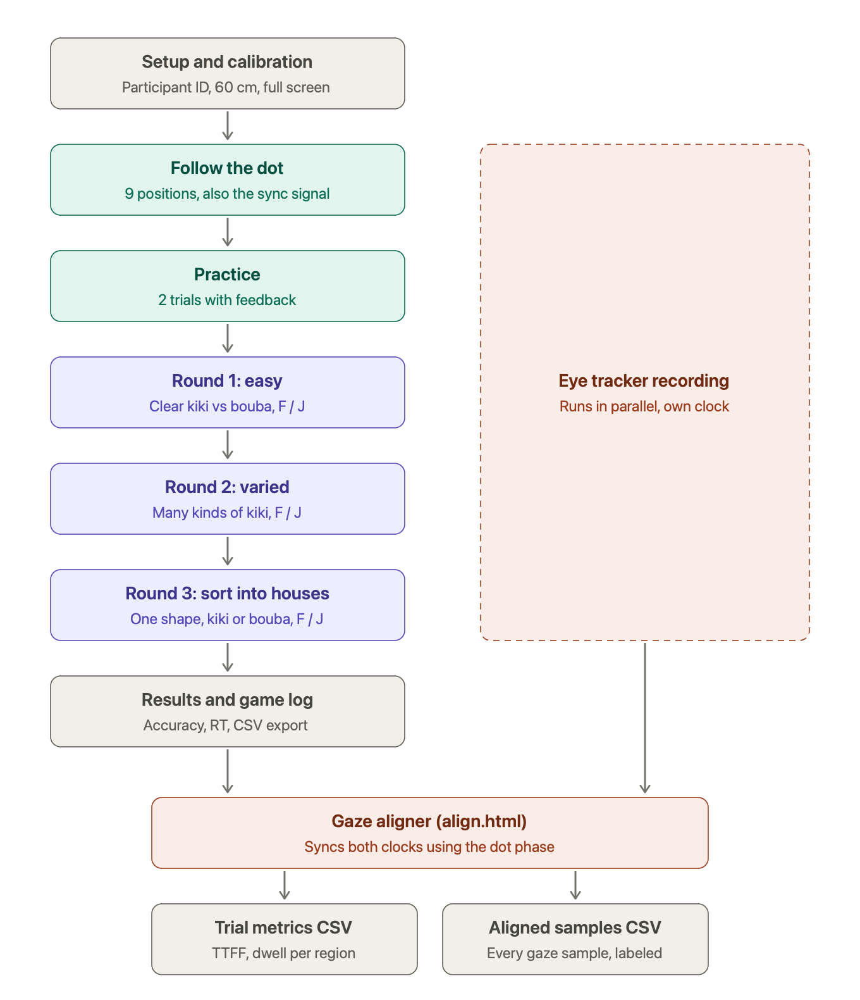

# Kiki / Bouba eye-tracking pilot

A short warm-up task for getting participants used to an eye tracker (SCI 6384, Harvard GSD).

**Play in the browser:** https://yvettege728.github.io/kiki-bouba-pilot/

**Run offline:** download `kiki-bouba-pilot.html` (or Code > Download ZIP) and open it in Chrome. No install, no internet needed.

## Flow (about 3 min)

Vector version: [flowchart.svg](flowchart.svg)

1. Follow the dot: 9 positions, 1.5 s each (accuracy check against the tracker)
2. Practice: 2 trials with feedback
3. Round 1, easy: clear kiki vs. bouba, keys `F` / `J`
4. Round 2, varied: kikis and boubas with different spike counts, sizes, irregularity and rotation, keys `F` / `J`
5. Round 3, sort: one shape at a time goes into the KIKI house or the BOUBA house (keys `F` / `J`; the shape slides into the chosen house). Shapes run from round to spiky, plus hybrids that are half spiky, half round. Ambiguous shapes have no right answer: the point is to see which features people look at before deciding
6. Results screen with CSV / JSON download

## Controls built in

- 800 ms central fixation cross before every trial
- Parametric shapes with equal area, positions counterbalanced
- Keyboard responses, cursor hidden, 10 s timeout, 500 ms blank between trials
- Sync patch in the bottom-left corner turns white while a stimulus is on screen (for aligning tracker recordings)
- Pixel AOI coordinates for every shape are logged per trial; hybrids also log separate spiky and round AOIs
- House sides (kiki left or right) are randomized per participant
- `Esc` stops the session and still lets you save data

## Settings

Edit the `CFG` block at the top of the script to change timings or the number of trials.

## Aligning gaze data: `align.html`

The game does not connect to the eye tracker. Record gaze in the tracker software as usual, then open the aligner:

**https://yvettege728.github.io/kiki-bouba-pilot/align.html** (runs in the browser, nothing is uploaded)

1. Drop the game CSV and the tracker's gaze export (CSV or TSV: Tobii Pro Lab, Gazepoint, Pupil Labs and similar exports are auto-detected)
2. Check the detected columns, time unit and coordinate type
3. Click **Align and compute**

How it syncs: the follow-the-dot phase is the sync signal. The aligner searches for the clock offset at which gaze best lands on the 9 dots, so no hardware trigger is needed. Expected timing precision is about ±50 ms (individual saccade latency is unknown). The sync check plot and the median error in pixels show whether the alignment and calibration are good. Above about 60 px, check the coordinate settings or recalibrate.

Outputs:
- **Trial metrics CSV**: per trial, time to first fixation and dwell time per region (target / other in rounds 1 and 2; spiky half / round half of hybrid shapes, shape, kiki house, bouba house in round 3), first and last region looked at, accuracy, RT
- **Aligned samples CSV**: every gaze sample in game time with its trial and region

Note on round 3: the shape appears where the fixation cross was, so gaze starts on the shape. Use dwell on the spiky vs. round half and the last region before the response, not time to first fixation.
