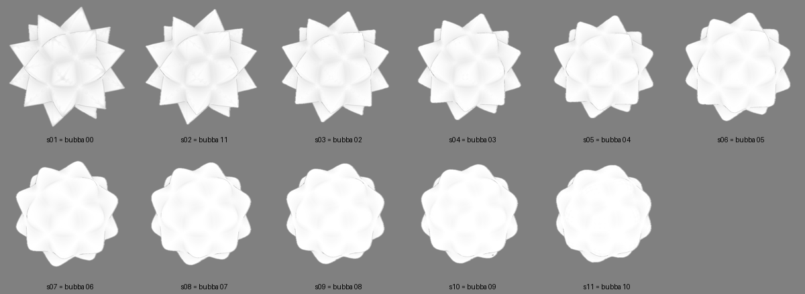
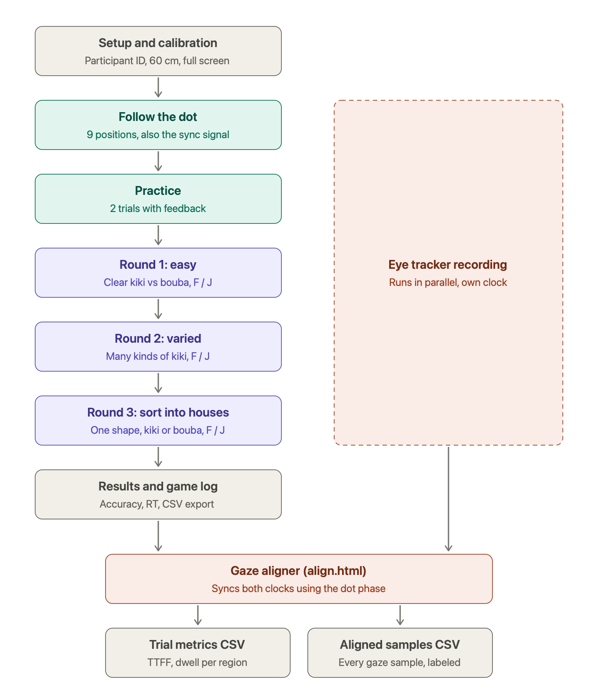

# Kiki / Bouba study (SCI 6384, Harvard GSD)

This repo holds two programs:

| Program | What it is | Open |
|---|---|---|
| **Visual condition** (`visual/`) | The main study: 11 rendered 3D shapes from sharp to round, 3 rounds, kiki/bouba choice + confidence, Pupil Neon eye tracking | https://yvettege728.github.io/kiki-bouba-pilot/visual/kiki-bouba-visual.html |
| **Pilot / warm-up** (`kiki-bouba-pilot.html`) | Earlier 3-minute warm-up task for getting participants used to an eye tracker | https://yvettege728.github.io/kiki-bouba-pilot/ |

The haptic (touch) condition runs with physical 3D-printed shapes and is not part of this repo.

## Visual condition: `visual/kiki-bouba-visual.html`

**Run offline (recommended on test day):** download the `visual/` folder (or Code > Download ZIP), keep `kiki-bouba-visual.html` and the `stimuli/` folder side by side, open the HTML in Chrome, full screen. No install, no internet needed.

### Stimuli



`visual/stimuli/s01.png` ... `s11.png`: renders of the same 3D objects used in the touch condition, 1000 x 1000 px on a #808080 grey background, all at one common scale. The number is the corner-radius level: **1 = sharpest, 11 = roundest**. The log also writes `angular_pct = (11 - n) x 10`, so s01 = 100 and s11 = 0.

### Procedure (about 8 min)

1. Setup screen: participant ID, optional Neon phone IP. Odd ID numbers get KIKI on the left (`F`), even IDs get KIKI on the right (`J`).
2. Follow the dot: a dot visits several screen positions, 1.5 s each, to check gaze accuracy.
3. Three rounds of 11 trials (33 trials). Each trial:
   - fixation cross, 1 s
   - **observe 5 s**: shape on screen, countdown shown, keys locked (presses are logged as `early_press`)
   - **choose 3 s**: press `F` or `J` for kiki / bouba; no answer = `timeout`
   - confidence 1-5 (keys `1`-`5`, up to 8 s)
   - blank, 0.5 s
4. End screen with **Download CSV / Download JSON**. `Esc` stops at any time and still lets you save.

Labels on screen are text only (no house or icon shapes, which could hint at curves vs. corners).

### Fixed trial order

Every participant sees the same order:

| Round | Order (stimulus numbers) |
|---|---|
| 1 | 4 7 1 5 2 9 3 8 11 6 10 |
| 2 | 2 7 3 11 4 9 6 1 8 5 10 |
| 3 | 3 6 2 8 4 10 7 11 5 9 1 |

Rules used to build it: neighbouring trials differ by 3-8 levels, the same shape is at least 5 trials apart, and no neighbour pair repeats. Every shape is shown 3 times so a logistic (S-curve) fit gives each person a threshold (where kiki turns into bouba) and a slope (how sharp the switch is).

### Pupil Neon

- Four AprilTags (tag36h11, IDs 0-3) sit in the screen corners the whole time. In Pupil Cloud, add a **Marker Mapper** enrichment and draw the surface on these four tags to get gaze in screen coordinates. The tags do not need to be created in Pupil Cloud.
- Every log row has `unix_ms` (UTC wall clock) for lining the log up with the Neon recording.
- Optional: type the phone IP from the Companion app ("Stream") to send events to the recording timeline (`http://IP:8080/api/event`). This only works when the HTML is opened as a local file; browsers block it from the https GitHub Pages link.

### Data columns

`pid, t_ms, unix_ms, wall, event, trial, block, stim_n, angular_pct, kiki_side, key, choice, confidence, rt_ms, early_presses, stim`

Events: `session_start`, `dot_on` / `dot_off`, `block_start`, `fixation`, `stim_on`, `early_press`, `choose_on`, `response` (key, choice, rt_ms), `confidence`, `session_end`.

### Fixing a participant who swapped left and right

```
python analysis/fix_label_flip.py kikibouba_visual_01_....csv kikibouba_visual_01_....json
```

Writes `_corrected` copies: `choice` is swapped for every answer, the original stays in `choice_raw`, and `correction` marks the change. Report this as a post-hoc correction. To avoid it, have the participant say "F = ..., J = ..." out loud before starting.

Do not commit participant data to this repo (`*.csv` is git-ignored).

---

## Pilot / warm-up: `kiki-bouba-pilot.html`

A short warm-up task for getting participants used to an eye tracker.

**Play in the browser:** https://yvettege728.github.io/kiki-bouba-pilot/

**Run offline:** download `kiki-bouba-pilot.html` (or Code > Download ZIP) and open it in Chrome. No install, no internet needed.

### Flow (about 3 min)



Vector version: [flowchart.svg](flowchart.svg)

1. Follow the dot: 9 positions, 1.5 s each (accuracy check against the tracker)
2. Practice: 2 trials with feedback
3. Round 1, easy: clear kiki vs. bouba, keys `F` / `J`
4. Round 2, varied: kikis and boubas with different spike counts, sizes, irregularity and rotation, keys `F` / `J`
5. Round 3, sort: one shape at a time goes into the KIKI house or the BOUBA house (keys `F` / `J`; the shape slides into the chosen house). Shapes run from round to spiky, plus hybrids that are half spiky, half round. Ambiguous shapes have no right answer: the point is to see which features people look at before deciding
6. Results screen with CSV / JSON download

### Controls built in

- 800 ms central fixation cross before every trial
- Parametric shapes with equal area, positions counterbalanced
- Keyboard responses, cursor hidden, 10 s timeout, 500 ms blank between trials
- Sync patch in the bottom-left corner turns white while a stimulus is on screen (for aligning tracker recordings)
- Pixel AOI coordinates for every shape are logged per trial; hybrids also log separate spiky and round AOIs
- House sides (kiki left or right) are randomized per participant
- `Esc` stops the session and still lets you save data

### Settings

Edit the `CFG` block at the top of the script to change timings or the number of trials.

### Aligning gaze data: `align.html`

The game does not connect to the eye tracker. Record gaze in the tracker software as usual, then open the aligner:

**https://yvettege728.github.io/kiki-bouba-pilot/align.html** (runs in the browser, nothing is uploaded)

1. Drop the game CSV and the tracker's gaze export (CSV or TSV: Tobii Pro Lab, Gazepoint, Pupil Labs and similar exports are auto-detected)
2. Check the detected columns, time unit and coordinate type
3. Click **Align and compute**

How it syncs: the follow-the-dot phase is the sync signal. The aligner searches for the clock offset at which gaze best lands on the 9 dots, so no hardware trigger is needed. Expected timing precision is about ±50 ms (individual saccade latency is unknown). The sync check plot and the median error in pixels show whether the alignment and calibration are good. Above about 60 px, check the coordinate settings or recalibrate.

Outputs:
- **Trial metrics CSV**: per trial, time to first fixation and dwell time per region (target / other in rounds 1 and 2; spiky half / round half of hybrid shapes, shape, kiki house, bouba house in round 3), first and last region looked at, accuracy, RT
- **Aligned samples CSV**: every gaze sample in game time with its trial and region

Note on round 3: the shape appears where the fixation cross was, so gaze starts on the shape. Use dwell on the spiky vs. round half and the last region before the response, not time to first fixation.

### Pupil Labs Neon recordings: `analysis/neon_align.py`

Neon is head-mounted, so gaze comes in scene-camera pixels and the screen moves in the view. `align.html` cannot map that; use this script instead. (For the visual condition, use the AprilTags + Marker Mapper described above.) It finds the screen in every scene-video frame (the game's gray background shows up as a saturated quad), corrects lens distortion, maps gaze and Neon's own fixations to game screen pixels, syncs clocks (wall-clock UTC, refined on the follow-the-dot phase) and writes per-trial metrics with the same regions as `align.html`, plus a `switches` count and a `prompt` region.

```
pip install opencv-python-headless numpy
python analysis/neon_align.py <neon_export_folder> <game_log.csv> <out_folder>
```

Input: the Neon "Timeseries Data + Scene Video" export (needs `gaze.csv`, `fixations.csv`, `world_timestamps.csv`, `scene_camera.json` and the `.mp4`). Do not commit participant data to this repo.

#### Pooling everything: `analysis/summarize.py`

```
python analysis/summarize.py <folder with kikibouba_*.csv game logs> <folder with gaze_trials_*.csv>
```

Joins every game log with the gaze metrics that exist, and writes `all_trials.csv`, `hybrid_trials.csv` and `pilot_summary.png` (habituation curve, rounds 1 vs 2 gaze, round 3 categorisation curve, hybrids last look vs answer).

Neon tip: participants who sit very close to the laptop push the screen edges out of the scene camera. Those frames cannot be mapped. Keep about 60 cm and check the scene view before starting.
